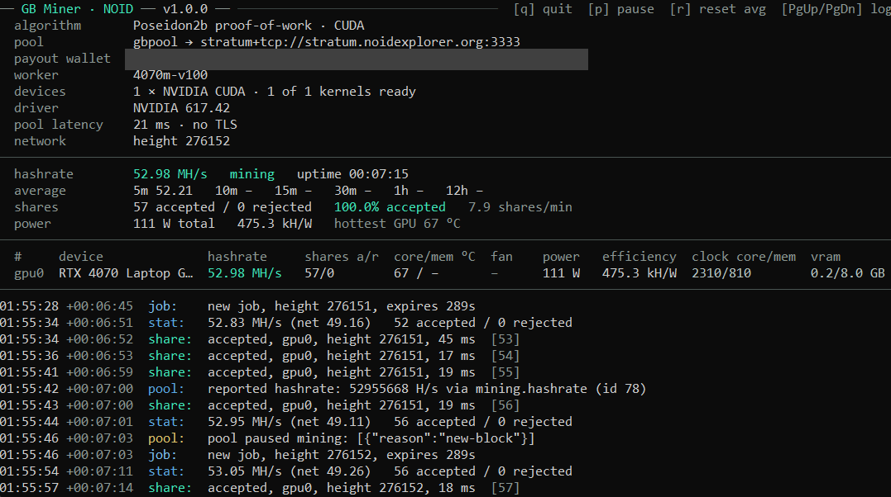
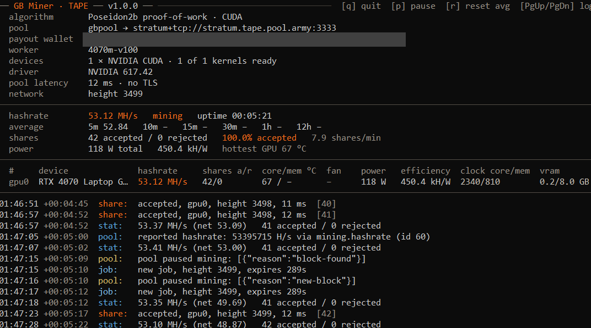

# GB Miner

<p>
  
  
</p>

**GB Miner** is a GPU miner for two coins that share the same proof of work (Poseidon2b): **Parano1d (NOID)** and **Retro Boomer (TAPE)**. It runs on NVIDIA GTX 16 and RTX 20/30/40/50-series cards, Volta (V100, Titan V, Quadro GV100), Hopper (H100) and GA100 (CMP 170HX, A100, A30), on Linux, Windows and HiveOS, with one download per platform. It speaks Stratum and HTTP pools natively.

You pick the coin with one setting, `COIN=noid` or `COIN=tape` (`--coin`). Without it the miner goes by your wallet address: `o1…` is NOID, `tape1…` is TAPE. The dashboard shows which coin you are mining: **GB Miner · NOID** in green, **GB Miner · TAPE** in orange.

GB Miner is the successor of [GB Parano1d Miner](https://github.com/gustlborg/gb-parano1d-miner) 3.0.6 and uses its kernels unchanged, so it reaches the same hashrate, for both coins.

**Current release: v1.0.0**

- **One miner for NOID and TAPE.** Each package has one start script per coin with the coin already set (`start-noid.sh` / `start-tape.sh`, on Windows `start-noid.bat` / `start-tape.bat`): fill in both once and switch by starting the other one. On the command line it is `--coin`, on HiveOS `COIN=` in the custom config; otherwise the wallet address decides.
- **Pools for both coins by name:**
  - NOID: the GB Pool and the pool names from 3.0.6, without `ariabrain` (AriaPool paused NOID mining on 18 October 2026).
  - TAPE: the GB Pool (`stratum.tape.pool.army`), suprnova, rplant and pqpool.
- **No pool fee on the GB Pool with this miner (0 %),** on all four ports and for both coins.
- **HiveOS:** The miner is now called `gb-miner`. The Pool URL field also takes `host:port`, a bare host name or a pool name.
- **Same kernels as GB Parano1d Miner 3.0.6** (RTX 20/30/40/50, GTX 16, Volta, GA100, Hopper). Mining modes, autotune, power limit and clock settings work as before.

---

## Download

Get the archive for your platform from [Releases](../../releases), unpack it, and run it from inside the folder.

| Platform | Archive |
|---|---|
| Linux | `gb-miner-1.0.0-linux.tar.gz` |
| Windows | `gb-miner-1.0.0-windows.zip` |
| HiveOS | `gb-miner-1.0.0.tar.gz` (custom-miner package) |

The Linux and Windows archives each contain a `SHA256SUMS` file with the SHA-256 of every file inside. The `SHA256SUMS` on the release page lists all three archives.

You do not need the CUDA Toolkit, only an NVIDIA driver, version 580 or newer. The Linux and HiveOS binaries run on any 64-bit Linux with glibc 2.31 or newer (Ubuntu 20.04 and later, current HiveOS images).

## Quick start

**Linux and Windows:** Each package holds one start script per coin, with the coin already set: `start-noid.sh` and `start-tape.sh` (Linux), `start-noid.bat` and `start-tape.bat` (Windows). Open the one for your coin in a text editor (on Windows right-click → Edit), fill in the block at the top, save, and start it. Fill in both once, and you switch coins by starting the other one:

| Field | What to put in |
|---|---|
| `WALLET` | your payout address, `o1…` in `start-noid.*`, `tape1…` in `start-tape.*` (required) |
| `WORKER` | the name shown on the pool (optional; blank = the computer's name) |
| `POOL` | `gbpool` (default, the GB Pool of the coin), another pool name of the coin (see [Pools](#pools)), or a pool address such as `stratum+tcp://tape.suprnova.cc:3352` (Suprnova's TAPE port for multi-GPU rigs) |
| `MODE` | optional: `balanced` (default), `performance` (highest hashrate) or `efficiency` (fewest watts per hash) |
| `LOCK_CORE_CLOCK`, `LOCK_MEM_CLOCK`, `CORE_OFFSET`, `POWER_LIMIT` | optional clock and power settings, e.g. `2705`, `810`, `300` on an RTX 5070 Ti; leave them blank to leave the card alone. They are applied at start and put back when the miner exits |

In the `.bat` files each line reads `set "FIELD=value"`, for example `set "WALLET=tape1…"`. Start it with `sh start-tape.sh` (or `sh start-noid.sh`) on Linux (with clock or power settings as root: `sudo sh start-tape.sh`). On Windows, double-click `start-tape.bat` or `start-noid.bat` (with clock or power settings: right-click → Run as administrator).

**Linux:** Or pass the full command line:
```
./gb-miner cuda-mine --coin tape --pool gbpool --coinbase <your-tape1-address> --worker rig0 --search-binary ./gb-miner-engine
./gb-miner cuda-mine --coin noid --pool gbpool --coinbase <your-o1-address> --worker rig0 --search-binary ./gb-miner-engine
```

**Windows:** Or, in PowerShell:
```
./gb-miner.exe cuda-mine --coin tape --pool gbpool --coinbase <your-tape1-address> --worker rig0 --search-binary gb-miner-engine.exe
```

**HiveOS:** Flight Sheet → Custom miner:
- Miner name: `gb-miner`
- Installation URL: `https://github.com/gustlborg/gb-miner/releases/download/v1.0.0/gb-miner-1.0.0.tar.gz`
- Wallet and worker template: `%WAL%.%WORKER_NAME%` (or your address)
- Pool URL: a pool address, `host:port` (taken as plain Stratum; for a TLS port write `stratum+tls://host:port`), or a pool name such as `gbpool`. Empty means the GB Pool of the coin.
- Custom user config: `COIN=tape` or `COIN=noid` (without it the wallet decides). Everything else is optional, for example `MODE=performance` or `LOCK_CORE_CLOCK=`, `LOCK_MEM_CLOCK=`, `CORE_OFFSET=` (see the README inside the package).

HiveOS derives the miner name from the archive's file name, so use exactly this URL and `gb-miner`. A flight sheet with the old miner name `parano1d` keeps running GB Parano1d Miner. To switch, create a flight sheet with `gb-miner`. On HiveOS the rig's OC profile owns the clocks: memory-clock autotune stays off there unless you add `AUTOTUNE=on`.

## Pools

`--pool` (`POOL` in the start scripts) takes a pool name of the coin you mine or a pool address. It detects Stratum or HTTP from the address. The default is the GB Pool of the coin. Each GB Pool has four ports, and all of them adjust the difficulty to your hashrate on their own:

| `--pool` | NOID (`stratum.noidexplorer.org`) | TAPE (`stratum.tape.pool.army`) | For |
|---|---|---|---|
| `gbpool` (default) | `:3333` | `:3333` | Recommended for everyone, CPU and GPU. |
| `gbpool-ssl` | `:3334` (TLS) | `:3334` (TLS) | The same, encrypted. |
| `gbpool-farm` | `:3335` | `:3335` | Farms, rentals and proxies; high start difficulty. |
| `gbpool-solo` | `:3336` | `:3336` | Solo: a block you find is yours alone. |

With this miner the GB Pool charges no pool fee (0 %) on all four ports, for both coins.

The other pools:

| Coin | Names |
|---|---|
| NOID | `innovlab`, `luckypool` / `luckypool-us` / `luckypool-asia`, `suprnova`, `alphapool`, `rplant` / `rplant-na` / `rplant-asia` (TLS), `parano1d` (HTTP); `noidexplorer` is another name for `gbpool` |
| TAPE | `suprnova` (`tape.suprnova.cc:3351`), `suprnova-ssl` (`:3357`), `suprnova-solo` (`:3358`), `rplant` / `rplant-na` / `rplant-asia` (TLS, port 17066), `pqpool` (`tape.pqpool.com:5555`), `pqpool-ssl` (`:5556`; for solo on PQPool write the wallet as `solo:tape1…`) |

For TAPE you can also paste a pool's web address (`https://tape.pool.army`, `https://tape.suprnova.cc`, `https://pool.rplant.xyz`, `https://pqpool.com`); the miner uses that pool's main Stratum port. A second pool can be given with `--backup-pool`. The miner switches over on its own if the main pool stops answering, and switches back when it returns.

## Hardware

Supported cards:
- **Native kernels:** GTX 16 and RTX 20/30/40/50-series, Volta, Hopper (H100; validated on the H100 NVL) and GA100 (validated on the CMP 170HX and the A100 SXM4).
- **Same chips:** Workstation and data-center cards with the same chips (for example the RTX A-series, A10/A40, L4/L40 and RTX PRO Blackwell) get the same native kernels. Their speed is not measured.
- **Fallback kernel:** Any other NVIDIA GPU with compute capability 8.0 or newer runs a JIT-compiled fallback kernel. It needs a driver with CUDA 13.3 support or newer.
- **Not supported:** Pascal (GTX 10-series) and older cards. In a mixed rig the miner skips such a card with a note and mines on the others.
- **Driver for Volta:** Volta cards need the 580 driver series.

One binary covers all of these generations, so a mixed rig needs no separate download.

## Measured hashrate

NOID and TAPE use the same proof of work and GB Miner uses the kernels of GB Parano1d Miner 3.0.6 unchanged, so these figures apply to both coins. They were measured with GB Parano1d Miner 3.0.5 and 3.0.6 while mining NOID. The first table: 3.0.5, live at the InnovLab pool on 28 October 2026, two 1-minute runs per mode (mean shown), with core clock, memory clock and core-clock offset set through the NVIDIA driver; with the miner's own settings (`LOCK_CORE_CLOCK`, `LOCK_MEM_CLOCK`, `CORE_OFFSET`) the power can differ by several percent. Displayed hashrate, board power from nvidia-smi; kH/W = kilohashes per second per watt. Every card tolerates a different offset; see "Same hashrate, less power" in the package README.

| GPU | Mode | Core clock / memory clock / offset | MH/s | Power | kH/W |
|---|---|---|---|---|---|
| RTX 3060 (Windows) | performance | 1750 MHz / 810 MHz / +200 MHz | 30.83 | 102.1 W | 302.0 |
| RTX 3060 (Windows) | balanced | 1750 MHz / 810 MHz / +200 MHz | 29.55 | 90.7 W | 325.8 |
| RTX 4060 Ti (Linux) | performance | 2450 MHz / 810 MHz / +250 MHz | 53.10 | 106.4 W | 499.1 |
| RTX 4060 Ti (Linux) | balanced | 2450 MHz / 810 MHz / +250 MHz | 52.66 | 103.3 W | 509.8 |
| RTX 5070 Ti (Linux) | performance | 2705 MHz / 810 MHz / +300 MHz | 117.72 | 206.3 W | 570.7 |
| RTX 5070 Ti (Linux) | balanced | 2705 MHz / 810 MHz / +300 MHz | 116.77 | 199.5 W | 585.2 |

On rented servers, at the host's settings (hashrate only): CMP 170HX, A100 and H100 NVL with 3.0.5 at the InnovLab pool on 28 October 2026 (mean of two 2-minute runs), RTX 2080 and Tesla V100 with 3.0.6 at the GB Pool.

| GPU | Power limit | MH/s |
|---|---|---|
| RTX 2080 | 150 W (set by the host) | 17.9 |
| Tesla V100 SXM2 | 300 W | 26.5 |
| CMP 170HX | 200 W (set by the host) | 280.3 |
| A100 SXM4 40GB | 400 W | 388.7 |
| H100 NVL | 400 W (set by the host) | 578.3 |

## Mining modes, autotune, power and clocks

- **Mining modes:** `--mode performance|balanced|efficiency` (`MODE=` in the start scripts and on HiveOS), default `balanced`. They apply to RTX 30, 40 and 50 cards; other GPUs run their one kernel.
- **Autotune:** It measures the lowest memory clock that still gives the full hashrate, once per card, and locks it while mining. This proof of work needs no memory bandwidth, so that saves power at the same hashrate. It is off on HiveOS unless you add `AUTOTUNE=on`.
- **Power and clocks:**
  - `--powerlimit`, `--lock-core-clock`, `--core-clock-offset` and `--lock-mem-clock` set the card for the run. At exit the miner puts the power limit and the offset back and releases the clock locks it set.
  - The power limit and the offset are checked against the card's allowed range first.
  - A locked core clock with a positive offset gives the same hashrate for much less power.
- **Multi-GPU:** By default the miner uses every supported GPU under one pool connection. `--devices 0,1,2` restricts it to the cards you list.

The README inside each package covers all of this in detail, with measurements per card.

## Developer fee

This miner mines a disclosed **2 % developer fee**, for both coins: into a NOID wallet when you mine NOID, into a TAPE wallet when you mine TAPE. On Stratum pools the fee runs as a second session to the same pool under your worker name, interleaved continuously rather than taken as one long block. The fee has no log lines of its own. Its shares are not counted in the miner's share totals, so the hashrate shown is the card's full rate. The fee wallets are never displayed; this README is the disclosure.

## Dashboard

In a terminal window the miner shows a live dashboard:
- **Title:** "GB Miner · NOID" or "GB Miner · TAPE".
- **Top:** pool, wallet, worker, pool latency and block height.
- **Middle:** hashrate with rolling averages, shares, power and efficiency.
- **Per GPU:** one row with hashrate, shares, temperatures, fan, power and clocks.
- **Bottom:** the scrolling log.

Keys: `q` quits cleanly, `p` pauses and resumes, `r` resets the averages, and `PgUp`/`PgDn` page through the log. Redirected output (HiveOS, a log file, a pipe) stays a plain log; `PARANO1D_PLAIN_OUTPUT=1` forces it.

## License

GB Miner is proprietary software, distributed as a binary release; see `LICENSE`. That license prohibits reverse engineering, decompilation, disassembly and analysis by any automated system (including large language models), except where such a prohibition is void under applicable mandatory law. Third-party components and their licenses are listed at the end of the same file.
